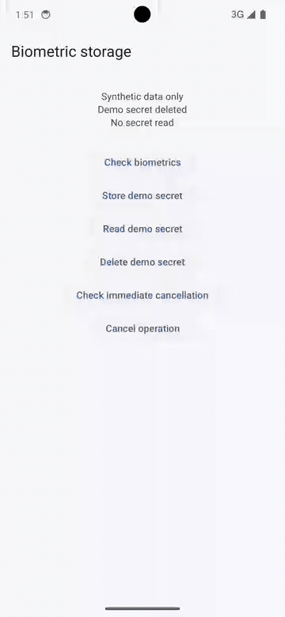
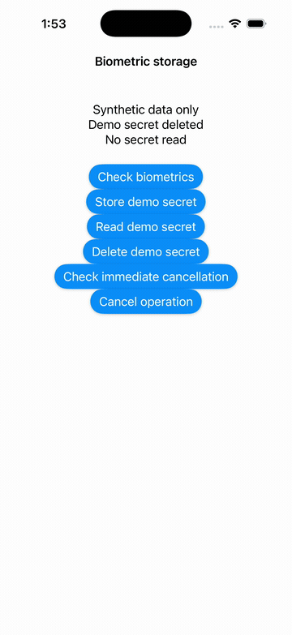

# biometric_storage_kit

Biometric-protected UTF-8 secret storage for DartNative on iOS and Android.

**Development version: 0.1.0-dev.1.** Local implementation; not published or
qualified for a production migration. See [validation](VALIDATION.md) for the
checks performed and the remaining device/upgrade gates.
Physical iPhone enforcement and a strict-policy synthetic upgrade from the original
`biometric_storage 5.0.1` have passed focused checks; full migration/release qualification
remains open. Reproduction fixtures are in [qualification](qualification/README.md).

| Platform | Native path | Protection for new records |
|---|---|---|
| iOS | Dart FFI → Swift → Keychain / LocalAuthentication | `whenPasscodeSetThisDeviceOnly` + `biometryCurrentSet` |
| Android | Dart FFI → C++ JNI → Kotlin → Keystore / BiometricPrompt | AES-256-GCM key requiring a strong biometric for every crypto operation |

Original code is Apache-2.0. This is a storage service, with no wallet signing,
account recovery decisions, backend identity, or application navigation.

## Local use

Until a repository and catalogue release are authorized, use a relative path:

```yaml
dependencies:
  biometric_storage_kit:
    path: ../biometric_storage_kit
```

Run `dn pub get` and call the application's generated
`DartNativePluginRegistrant.registerAll()` before `runApp`. Use the plugin from
the **main isolate**. It supports one native operation at a time across instances.

```dart
import 'package:biometric_storage_kit/biometric_storage_kit.dart';

final storage = BiometricStorage(namespace: 'my-app');
final availability = await storage.checkAvailability();

if (availability == BiometricAvailability.available) {
  await storage.write('example', 'Synthetic secret');
  final value = await storage.read('example'); // String?; prompts independently
}

// Explicit deletion does not require biometric authentication.
await storage.delete('example');
storage.dispose();
```

The namespace and name are part of the record identity. Keep them stable across
upgrades. Names may contain valid Unicode; no Unicode normalization is performed.
Namespaces are limited to 128 UTF-8 bytes, names to 512, prompt fields to 1024,
and secrets to 65,536. Empty secrets are valid. Empty identifiers, embedded NUL
in identifiers/prompts, and malformed Unicode are rejected before native work.

`read` returns `null` only when the OS reports no stored item/file. This does not
prove a secret never existed: iOS can remove items following protection changes.
A missing Android key with existing ciphertext is an error, never absence.

## Platform setup

Verified with DartNative 1.4.0 and Dart 3.12.0-192.0.dev. The plugin declares iOS
15+ and Android API 26+. These are build floors, not a claim that every OS version
has been exercised. Android hosts must be resumed `FragmentActivity` instances;
the audited DN activity satisfies this requirement. The plugin manifest declares
`USE_BIOMETRIC` and the legacy `USE_FINGERPRINT` permission.

On iOS, set `NSFaceIDUsageDescription` in the host's Info.plist and use a correctly
signed application with its own Keychain identity. The included example has a
**simulator-only** entitlement configuration; a physical-device build needs the
developer's real signing/provisioning configuration. Do not copy the simulator
identity into a production device entitlement or change an existing app's access
groups during migration. See [example setup](example/README.md).

There is no passcode fallback for new records. Android requires a strong enrolled
biometric. iOS writes request explicit biometric approval, and reads are enforced
by the item's Keychain access control. A standalone biometric prompt followed by
unrestricted storage is not used.

## Prompts and cancellation

```dart
const prompt = BiometricPromptOptions(
  title: 'Protected storage',                 // Android
  reason: 'Read the saved demo secret',
  cancelLabel: 'Cancel',
  iosReuseDuration: Duration.zero,
);
final value = await storage.read('example', prompt: prompt);
```

iOS reuse duration accepts zero through five minutes. It concerns a recent
**device-unlock biometric match**, not a cache of arbitrary app authentication.
Android always authorizes the individual cryptographic operation.

Overlapping requests fail with `busy`. On Android, a cancelled prompt can remain
busy briefly while its terminal callback drains. `cancelPending()` targets only
that instance's active operation; `dispose()` also rejects future operations.
Backgrounding cancels pending prompt ownership. Native host/isolate changes
invalidate stale work and callbacks.

Cancellation, native reset, or the three-minute timeout cannot undo an already
committed write/delete. Treat the result as uncertain and reconcile explicitly;
never blindly retry a mutation. The plugin performs no automatic retry, key
rotation, error-triggered deletion, or reset.

## Errors and retained data

Catch `BiometricStorageException` and inspect `code`; `nativeCode` is available
when the OS supplies a numeric code. Messages never include secret values.

| Code | Meaning / handling |
|---|---|
| `cancelled`, `busy`, `timeout`, `native_reset` | Interrupted/overlapping work; respect uncertain mutation outcomes |
| `not_enrolled`, `unavailable`, `locked_out`, `passcode_not_set` | Authentication prerequisites or OS restrictions |
| `authentication_failed`, `interaction_not_allowed`, `invalid_context` | Authentication/context failure; no secret is returned |
| `key_missing`, `key_invalidated`, `unsupported_key_policy` | Android key unavailable or policy does not satisfy this API; preserve ciphertext |
| `corrupt_data`, `storage_error` | Invalid data or storage failure; never treated as missing |
| `no_foreground_host`, `engine_detached`, `unsupported_runtime`, `native_unavailable` | Host/runtime cannot execute the request |
| `invalid_request`, `invalid_response` | Invalid native boundary data |

Android stores versioned IV/ciphertext/tag records in `noBackupFilesDir`, with
namespace/name authenticated as additional data. Writes sync a temporary file
then replace the target atomically in the same directory. Keys are not exportable
through this API; hardware backing is not promised. Mutable plaintext byte buffers
are cleared where possible; Dart/JVM/Swift strings cannot guarantee memory wiping.

## Read-only Flutter compatibility

`readLegacyFlutter(originalName)` reads the audited **biometric_storage 5.0.1**
format under the same signed application identity. It does not migrate, rewrite,
or delete the old record. The application's existing storage namespace/name,
signing identity, data container and access-group continuity must be preserved.

- iOS uses service `flutter_biometric_storage`, the original account name and
  default access group. The existing item's ACL controls access; the legacy API
  does not retrofit new protection onto weak or passcode-enabled legacy items.
- Android uses `filesDir/biometric_storage/<name>.v2.txt`, alias
  `_CM_<name>_master_key`, and the legacy 12-byte IV + ciphertext/tag layout.
  Only existing per-use biometric-bound keys are accepted. No new key is generated
  when reading. Unprotected, time-window, or credential-enabled legacy policies
  are outside this API. Legacy names must be one safe filename component.
- The same 64 KiB secret limit applies. Non-default iOS access groups and other
  plugin versions/formats are unqualified.

An app may read the old value, write it under a new namespace, verify it, and then
perform its own migration/activation protocol. Do not infer successful historical
upgrade or account recovery from a new-install demo. This package has no authority
to decide when old data can be retired.

## Demo and validation

The example uses only synthetic data on dedicated devices with no Orb applications.
Native recordings are used because the audited Marionette integration requires
Flutter and cannot drive DartNative's native UI.

### Android emulator



API 34 emulator: separate authenticated write and read, Unicode verification,
explicit deletion and an absent read.

### iOS Simulator



Simulator 26.5: simulated Face ID approves the explicit write, followed by read,
delete and absence. **This is not proof of Keychain read authentication.** This
simulator returned the value without a second match, including after cold launch.
[Apple's published Security source](https://github.com/apple-oss-distributions/Security/blob/db15acbe6a7f257a859ad9a3bb86097bfe0679d9/keychain/securityd/SecDbKeychainItemV7.m#L652-L656)
contains a simulator path that skips ACL-constrained wrapping, consistent with
that observation; the exact source revision was not matched to this runtime.
Focused physical-device read enforcement checks are recorded in [validation](VALIDATION.md).
Enrollment-change and passcode-removal qualification remain open.

[Validation and remaining qualification](VALIDATION.md) ·
[Example and reproducible checks](example/README.md) ·
[Implementation contract](PLAN.md) · [Provenance](provenance.json)

## Licence and notices

See [LICENSE](LICENSE), [NOTICE](NOTICE) and
[THIRD_PARTY_NOTICES.md](THIRD_PARTY_NOTICES.md). Notices are embedded below so the
official catalogue artifact retains them.

<!-- BEGIN DISTRIBUTION NOTICES -->
biometric_storage_kit
Copyright 2026 the biometric_storage_kit contributors.
Original code is licensed under Apache-2.0.

# Third-party notices

Scaffold: DartNative 1.4.0 official plugin template; no SDK runtime source or
binaries redistributed. Original FFI transport adapted from Apache-2.0
quick_actions_kit, Copyright 2026 the quick_actions_kit contributors.

biometric_storage 5.0.1 was consulted for API and persisted format compatibility;
new implementation is original. Its MIT licence is retained below. Its Android
CryptographyManager reference additionally credits the Android Open Source Project
under Apache-2.0 (see LICENSE). No private Orb implementation is copied.

MIT License

Copyright (c) 2019 Herbert Poul (@hpoul)

Permission is hereby granted, free of charge, to any person obtaining a copy
of this software and associated documentation files (the "Software"), to deal
in the Software without restriction, including without limitation the rights
to use, copy, modify, merge, publish, distribute, sublicense, and/or sell
copies of the Software, and to permit persons to whom the Software is
furnished to do so, subject to the following conditions:

The above copyright notice and this permission notice shall be included in all
copies or substantial portions of the Software.

THE SOFTWARE IS PROVIDED "AS IS", WITHOUT WARRANTY OF ANY KIND, EXPRESS OR
IMPLIED, INCLUDING BUT NOT LIMITED TO THE WARRANTIES OF MERCHANTABILITY,
FITNESS FOR A PARTICULAR PURPOSE AND NONINFRINGEMENT. IN NO EVENT SHALL THE
AUTHORS OR COPYRIGHT HOLDERS BE LIABLE FOR ANY CLAIM, DAMAGES OR OTHER
LIABILITY, WHETHER IN AN ACTION OF CONTRACT, TORT OR OTHERWISE, ARISING FROM,
OUT OF OR IN CONNECTION WITH THE SOFTWARE OR THE USE OR OTHER DEALINGS IN THE
SOFTWARE.
<!-- END DISTRIBUTION NOTICES -->
